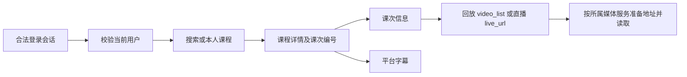

# 延河课堂接口参考

**当前版本：0.2.0** · [GitHub 仓库](https://github.com/1whoarei1/yanhe-api-reference) · [更新记录](CHANGELOG.md)

供 SDK、命令行、浏览器扩展和其它客户端开发使用的底层协议资料。覆盖新版延河课堂、旧版延河课堂，以及配套的新旧乐学及旧版课程索引。各系统的认证、编号和响应格式分别记录。

这是社区整理的接口观察记录，不是平台官方规范。当前核对日期为 **2026-10-28**；源码基线为 Yanhe Refine `32bdf8c` (0.10.0) 和 yanhekit `cb270ee`。新增 AutoSlides `746cd87` 的索引契约及旧版视频元数据协议；定点网络核对范围见证据文档。

感谢 **[bit-admin / Yanhekt-AutoSlides](https://github.com/bit-admin/Yanhekt-AutoSlides)** 公开 session 索引、在线查询接口与旧站元数据研究，为旧版课程检索和课次接入提供了重要支持。具体来源、修订及 Apache-2.0 许可见 [来源与致谢](SOURCES.md)。

## 从这里开始

| 资料 | 内容 |
| --- | --- |
| [通用约定](docs/common.md) | 系统边界、编号、认证、时间单位、业务码和分页 |
| [新版延河课堂](docs/modern.md) | 登录态、课程搜索、课次、直播、平台字幕与资料 |
| [旧版课程索引](docs/autoslides.md) | 按学期搜索课程、course→session、索引覆盖与不可用处理 |
| [两份目录与导入](docs/catalogs.md) | 新版课程表、自建旧版 session 快照与明确的课程归属 |
| [自建 session 索引采集](docs/session-index-server.md) | 服务器后台采集、五并发、断点续跑与明文课程目录 |
| [旧版延河课堂](docs/legacy.md) | 独立认证、请求头、课程 / session / live 与播放凭据 |
| [媒体与字幕](docs/media.md) | 视频地址签名、HLS / FLV / MP4、字幕修订和时间单位 |
| [新乐学](docs/lms-new.md) | 本人课程、作业、附件、完整上传与提交链路 |
| [旧乐学 Moodle](docs/lms-old.md) | 会话、课程 RPC、活动 HTML 和真实附件链接 |
| [yanhekit 对照与整合](docs/yanhekit.md) | 共用接口、实现差异、可复用能力和边界 |
| [证据与维护](docs/verification.md) | 已知验证范围、脱敏、变更核对和待确认问题 |
| [机器可读接口清单](catalog/endpoints.json) | 51 个接口 / 路径族及可定位的源码证据 |

## OpenAPI 3.1

按系统分别生成，避免把四种登录态混在同一个客户端里：

- [新版延河课堂](openapi/modern.json)
- [旧版延河课堂](openapi/legacy.json)
- [新乐学及其媒体上传路径](openapi/lms.json)
- [旧乐学 Moodle](openapi/lexue.json)
- [旧版课程索引](openapi/autoslides.json)

可以导入支持 OpenAPI 3.1 的工具。文件记录观察到的请求和响应字段，保留未知字段；它们不是对服务端完整数据结构、权限或可用性的承诺。`x-evidence` 给出来源，`x-response-fields` 给出实际消费字段。响应示例均为合成数据。

## 最短的读取链路



网页版显示地址、JSON 接口地址、返回的视频地址是三个层次。课程存在、课次存在、回放生成、页面许可和媒体响应也分别判断；课程目录本身不是播放可用性证明。

旧版回放以 **session** 为目标，先从 `/v1/course/session?session_id=…` 返回值解析父课程，再读取对应录像。`/course/71990` 与 `/session/71990` 是不同对象；详见 [身份关系与定点核对](docs/legacy.md#以-session-定位回放)。旧版 XLSX 表不分发；两款插件正式 Release 已提供新表与自建明文 session 快照，格式和导入见 [目录数据](docs/catalogs.md)。

## 维护

Node.js 20+，无第三方依赖：

```sh
npm run docs:check
npm run docs:generate
```

需要核对来源时，显式提供本地参考仓库目录；不会自行克隆、安装或运行参考项目：

```sh
node tools/api-docs.mjs --source refine=/path/to/yanhe-refine --source yanhekit=/path/to/yanhekit
```

源码锚点核对、已纳入模块的新增字面量接口检查、生成文件及文档链接校验均在本地完成。接口清单是入口；新增参数和异常行为也应更新对应正文。详细贡献方式见 [CONTRIBUTING.md](CONTRIBUTING.md)。

## 来源与许可

感谢 [windlandneko/yanhekit](https://github.com/windlandneko/yanhekit)、[1whoarei1/yanhe-refine](https://github.com/1whoarei1/yanhe-refine)、[1whoarei1/yanhe-replay](https://github.com/1whoarei1/yanhe-replay)、[lankerr/BIT_yanhe_download_2026](https://github.com/lankerr/BIT_yanhe_download_2026)、[BITNP/BIT_yanhe_download](https://github.com/BITNP/BIT_yanhe_download) 及 [Moodle](https://github.com/moodle/moodle) 的作者与维护者。

本目录的原创文档与维护脚本采用 [MIT](LICENSE)。参考项目保留各自许可证，详见 [来源说明](SOURCES.md)。这里整合接口事实和客户端行为对照，不包含上游 Python 实现、账号凭据、私人课程目录或教学内容。

## 接口索引

以下表格由 `catalog/endpoints.json` 生成。字段中的固定分页值通常是参考客户端的选择，不能解释为平台上限；参数和状态的细节见各系统正文。

<!-- api-index:start -->

### 新版延河课堂

基础地址：`https://aita.yanhekt.cn`。会话：合法新版会话对应的 Bearer；参考客户端还保存该会话 Cookie。

| 编号 | 请求 | 参数 / 请求体 | 消费的返回字段 | 来源 |
| --- | --- | --- | --- | --- |
| `modern.profile` | `GET /userapi/v1/infosimple` | 无业务参数 | code=200；params.id / tenant_id / phone / account | [源码](https://github.com/1whoarei1/yanhe-refine/blob/32bdf8cd999fa3f9343b639ec46d6f1ff7241311/src/watch/api.js)；[yanhekit Yanhekt.authenticate](https://github.com/windlandneko/yanhekit/blob/cb270ee0aa037400bc7d92bbb518392b804d6513/skills/yanhekit/scripts/client.py) |
| `modern.enrolled` | `GET /vlabpassportapi/v1/account-profile/course` | force_mycourse=1, nowpage, per-page=100 | code=1000；params.result.data / total | [源码](https://github.com/1whoarei1/yanhe-refine/blob/32bdf8cd999fa3f9343b639ec46d6f1ff7241311/src/platform-api.js)；[yanhekit Yanhekt.courses](https://github.com/windlandneko/yanhekit/blob/cb270ee0aa037400bc7d92bbb518392b804d6513/skills/yanhekit/scripts/client.py) |
| `modern.terms` | `GET /vlabpassportapi/v1/course/term-list` | 无业务参数 | params.list[]：id / term_name；适配器允许 code=1000/0/200 | [源码](https://github.com/1whoarei1/yanhe-refine/blob/32bdf8cd999fa3f9343b639ec46d6f1ff7241311/src/platform-api.js)；[yanhekit Yanhekt.search](https://github.com/windlandneko/yanhekit/blob/cb270ee0aa037400bc7d92bbb518392b804d6513/skills/yanhekit/scripts/client.py) |
| `modern.colleges` | `GET /vlabpassportapi/v1/user/structures` | 无业务参数 | params.data：院系树，id / display_name；code=1000/0/200 | [源码](https://github.com/1whoarei1/yanhe-refine/blob/32bdf8cd999fa3f9343b639ec46d6f1ff7241311/src/platform-api.js)；[yanhekit Yanhekt.search](https://github.com/windlandneko/yanhekit/blob/cb270ee0aa037400bc7d92bbb518392b804d6513/skills/yanhekit/scripts/client.py) |
| `modern.search` | `GET /courseapi/v3/multi-search/get-course-list` | tenant, title, order, page, per_page=40；可选 term / struc_ids[]；tenant-id 请求头 | data.list / total；list 行含 id / title / realname / term_name / kkxy_name | [源码](https://github.com/1whoarei1/yanhe-refine/blob/32bdf8cd999fa3f9343b639ec46d6f1ff7241311/src/platform-api.js)；[yanhekit Yanhekt.search](https://github.com/windlandneko/yanhekit/blob/cb270ee0aa037400bc7d92bbb518392b804d6513/skills/yanhekit/scripts/client.py) |
| `modern.course` | `GET /courseapi/v3/multi-search/get-course-detail` | course_id | data.title / realname / term_name / sub_list / zhiyuan_id | [源码](https://github.com/1whoarei1/yanhe-refine/blob/32bdf8cd999fa3f9343b639ec46d6f1ff7241311/src/watch/api.js)；[yanhekit Yanhekt.course](https://github.com/windlandneko/yanhekit/blob/cb270ee0aa037400bc7d92bbb518392b804d6513/skills/yanhekit/scripts/client.py) |
| `modern.today` | `GET /courseapi/v2/course-live/get-my-course-day` | day：YYYY-MM-DD | list.*.course[]：course_id / sub_id / course_begin / course_over / room_name / sub_status | [源码](https://github.com/1whoarei1/yanhe-refine/blob/32bdf8cd999fa3f9343b639ec46d6f1ff7241311/src/platform-api.js) |
| `modern.teacher-courses` | `GET /courseapi/v3/multi-search/get-course-teacher-others` | course_id, per_page=20 | data[]：课程行；适配器排除测试条目 | [源码](https://github.com/1whoarei1/yanhe-refine/blob/32bdf8cd999fa3f9343b639ec46d6f1ff7241311/src/platform-api.js) |
| `modern.lecture` | `GET /courseapi/v3/portal-home-setting/get-sub-info` | course_id, sub_id | data.duration / video_list；直播为 sub_type / sub_status / live_url | [源码](https://github.com/1whoarei1/yanhe-refine/blob/32bdf8cd999fa3f9343b639ec46d6f1ff7241311/src/watch/api.js)；[yanhekit Yanhekt.lecture](https://github.com/windlandneko/yanhekit/blob/cb270ee0aa037400bc7d92bbb518392b804d6513/skills/yanhekit/scripts/client.py) |
| `modern.page-permission` | `GET /coursesourceapi/course/study-auth/{courseId}/{subId}` | 路径课程、课次编号；Tenant-Id 与当前 profile.account 对应的 username 请求头 | code=200；data.hasPermission：页面许可诊断值 | [源码](https://github.com/1whoarei1/yanhe-refine/blob/32bdf8cd999fa3f9343b639ec46d6f1ff7241311/src/watch/api.js) |
| `modern.subtitles` | `GET /courseapi/v3/web-socket/search-trans-result` | sub_id, format=json | list[].all_content[]：BeginSec / EndSec / Text；时间单位秒 | [源码](https://github.com/1whoarei1/yanhe-refine/blob/32bdf8cd999fa3f9343b639ec46d6f1ff7241311/src/watch/api.js)；[yanhekit Yanhekt.fast_transcript](https://github.com/windlandneko/yanhekit/blob/cb270ee0aa037400bc7d92bbb518392b804d6513/skills/yanhekit/scripts/client.py) |
| `modern.materials` | `GET /courseapi/v3/course-share-resource/get-course-resource` | course_id, page, per_page=100 | data[]：id / resource_id / old_resource_id / resource_name / resource_suffix / resource_size | [源码](https://github.com/1whoarei1/yanhe-refine/blob/32bdf8cd999fa3f9343b639ec46d6f1ff7241311/src/platform-api.js) |
| `modern.material-download` | `GET /spidermaterial/spider-material/web/download/dlUrl` | ids：平台资料的 resource_id 或 old_resource_id | state=200；data：下载地址字符串 | [源码](https://github.com/1whoarei1/yanhe-refine/blob/32bdf8cd999fa3f9343b639ec46d6f1ff7241311/src/platform-api.js) |

### 旧版延河课堂

基础地址：`https://cbiz.yanhekt.cn`。会话：旧站独立 Bearer 与 Xclient 请求头。

| 编号 | 请求 | 参数 / 请求体 | 消费的返回字段 | 来源 |
| --- | --- | --- | --- | --- |
| `legacy.profile` | `GET /v1/user` | 无业务参数 | code=0；data.id / badge | [源码](https://github.com/1whoarei1/yanhe-refine/blob/32bdf8cd999fa3f9343b639ec46d6f1ff7241311/src/watch/legacy-api.js) |
| `legacy.enrolled` | `GET /v2/course/private/list` | page, page_size=100, user_relationship_type=1 | data.data / last_page / total；课程含 name_zh / professors / school_year / semester | [源码](https://github.com/1whoarei1/yanhe-refine/blob/32bdf8cd999fa3f9343b639ec46d6f1ff7241311/src/platform-api.js) |
| `legacy.course` | `GET /v1/course` | id：课程编号；with_professor_badges=true | data.id / name_zh / professors / school_year / semester | [源码](https://github.com/1whoarei1/yanhe-refine/blob/32bdf8cd999fa3f9343b639ec46d6f1ff7241311/src/watch/legacy-api.js) |
| `legacy.sessions` | `GET /v2/course/session/list` | course_id：从课程实体或 session 归属响应取得的父课程编号 | data[]：session.id / started_at / title / videos[].id / duration / main / room / vga；一个 session 可有多个 video | [源码](https://github.com/1whoarei1/yanhe-refine/blob/32bdf8cd999fa3f9343b639ec46d6f1ff7241311/src/watch/legacy-api.js) |
| `legacy.session` | `GET /v1/course/session` | session_id：目标课次编号；with_video=true | data.id / course_id / course.id / title / video_ids；解析 session 的实际父课程，兼容 session.course_id | [源码](https://github.com/1whoarei1/yanhe-refine/blob/32bdf8cd999fa3f9343b639ec46d6f1ff7241311/src/watch/legacy-api.js) |
| `legacy.live-list` | `GET /v2/live/list` | source_id：旧站 course ID；page=1, page_size=100 | data.data[] / data[]：id / source_id / course.id / started_at / status / target / target_vga / target_room | [源码](https://github.com/1whoarei1/yanhe-refine/blob/32bdf8cd999fa3f9343b639ec46d6f1ff7241311/src/watch/legacy-api.js) |
| `legacy.live` | `GET /v1/live` | id：直播编号；with_session=true, with_course=true | data.course_id / session_id / status / target / target_vga / target_room | [源码](https://github.com/1whoarei1/yanhe-refine/blob/32bdf8cd999fa3f9343b639ec46d6f1ff7241311/src/watch/legacy-api.js) |
| `legacy.video-token` | `GET /v1/auth/video/token` | id：当前 profile.badge 或 0 | data.token / expired_at / now：短期播放凭据及有效期 | [源码](https://github.com/1whoarei1/yanhe-refine/blob/32bdf8cd999fa3f9343b639ec46d6f1ff7241311/src/watch/legacy-api.js) |
| `legacy.subtitles` | `GET /v1/video/subtitle/list` | video_id：视频编号，非课程或 session 编号 | data[]：language / url / src；再读取选中的 VTT/SRT 文件 | [源码](https://github.com/1whoarei1/yanhe-refine/blob/32bdf8cd999fa3f9343b639ec46d6f1ff7241311/src/watch/legacy-api.js) |
| `legacy.video` | `GET /v1/video` | id 是经过 session.video_ids 验证的视频片段 ID | code=0；data.id/main/vga/room/audio/duration；course_id/session_id 可能为 0，不作为归属依据 | [源码](https://github.com/bit-admin/Yanhekt-AutoSlides/blob/746cd87ccc4da59cb838adc023200531aa379a85/indexer/src/yanhekt.ts) |

### 新乐学

基础地址：`https://zy-eclass.bit.edu.cn`。会话：已登录会话；写请求在存在 XSRF-TOKEN 时携带 X-XSRF-TOKEN。

| 编号 | 请求 | 参数 / 请求体 | 消费的返回字段 | 来源 |
| --- | --- | --- | --- | --- |
| `lms.courses` | `GET /api/my-courses` | 无业务参数 | courses[] 或 data.courses[]：本人课程 | [源码](https://github.com/1whoarei1/yanhe-refine/blob/32bdf8cd999fa3f9343b639ec46d6f1ff7241311/src/lms-reader.js) |
| `lms.course-page` | `GET /course/{courseId}/content` | 路径课程编号 | HTML；#userId 的 data-id：当前学生编号 | [源码](https://github.com/1whoarei1/yanhe-refine/blob/32bdf8cd999fa3f9343b639ec46d6f1ff7241311/src/lms-reader.js) |
| `lms.activities` | `GET /api/course/{courseId}/courseware-activities` | 路径课程编号 | 数组或 learning_activities / courseware_activities / activities；检查 published 与活动归属 | [源码](https://github.com/1whoarei1/yanhe-refine/blob/32bdf8cd999fa3f9343b639ec46d6f1ff7241311/src/lms-reader.js) |
| `lms.homeworks` | `GET /api/courses/{courseId}/homework-activities` | 路径课程编号；page=1..100 | homework_activities / page / pages | [源码](https://github.com/1whoarei1/yanhe-refine/blob/32bdf8cd999fa3f9343b639ec46d6f1ff7241311/src/lms-reader.js) |
| `lms.homework-status` | `GET /api/course/{courseId}/homework/submission-status` | 路径课程编号 | homework_activities[]：id / status 等；失败时状态保持 unknown | [源码](https://github.com/1whoarei1/yanhe-refine/blob/32bdf8cd999fa3f9343b639ec46d6f1ff7241311/src/lms-reader.js) |
| `lms.resources` | `GET /api/activities/{activityId}/resources` | 路径活动编号；先检查本人课程和已发布活动 | uploads[]：id / reference_id / name / size / type / allow_download / deleted | [源码](https://github.com/1whoarei1/yanhe-refine/blob/32bdf8cd999fa3f9343b639ec46d6f1ff7241311/src/lms-reader.js) |
| `lms.task` | `GET /api/activities/{activityId}` | 路径作业活动编号 | course_id / type / data / uploads / is_in_progress / is_closed / submit_times 等 | [源码](https://github.com/1whoarei1/yanhe-refine/blob/32bdf8cd999fa3f9343b639ec46d6f1ff7241311/src/lms-reader.js) |
| `lms.current-group` | `GET /api/group-sets/{groupSetId}/group` | 当前作业 group_set_id | group.id / name；没有小组时禁止提交 | [源码](https://github.com/1whoarei1/yanhe-refine/blob/32bdf8cd999fa3f9343b639ec46d6f1ff7241311/src/lms-reader.js) |
| `lms.student-history` | `GET /api/activities/{activityId}/students/{userId}/submission_list` | 活动编号；userId 由当前会话课程页读取 | list[]：id / comment / created_at / is_draft / is_redo / uploads | [源码](https://github.com/1whoarei1/yanhe-refine/blob/32bdf8cd999fa3f9343b639ec46d6f1ff7241311/src/lms-reader.js) |
| `lms.group-history` | `GET /api/activities/{activityId}/groups/{groupId}/submission_list` | 活动编号；groupId 来自当前学生所属小组 | list[]：小组提交记录，字段同本人记录 | [源码](https://github.com/1whoarei1/yanhe-refine/blob/32bdf8cd999fa3f9343b639ec46d6f1ff7241311/src/lms-reader.js) |
| `lms.reference-download` | `GET /api/uploads/reference/{referenceId}/blob` | 附件 reference_id；仅 allow_download 开放时使用 | 文件或平台下载重定向；由浏览器下载 API 接收 | [源码](https://github.com/1whoarei1/yanhe-refine/blob/32bdf8cd999fa3f9343b639ec46d6f1ff7241311/src/lms-core.js) |
| `lms.own-download` | `GET /api/uploads/{uploadId}/blob` | 附件没有 reference_id 时使用其 id；仍检查 allow_download | 文件或下载重定向；用于个人提交附件等场景 | [源码](https://github.com/1whoarei1/yanhe-refine/blob/32bdf8cd999fa3f9343b639ec46d6f1ff7241311/src/lms-core.js) |
| `lms.folder-download` | `GET /zip/uploads` | timezone=-480, upload_ids：已开放下载的文件夹编号 | 平台生成的 ZIP 下载 | [源码](https://github.com/1whoarei1/yanhe-refine/blob/32bdf8cd999fa3f9343b639ec46d6f1ff7241311/src/lms-core.js) |
| `lms.create-upload` | **写入** `POST /api/uploads` | JSON：name / size / parent_type / parent_id 等固定字段，见正文 | id / upload_url / storage_type / transcoder；此步尚未传文件字节 | [源码](https://github.com/1whoarei1/yanhe-refine/blob/32bdf8cd999fa3f9343b639ec46d6f1ff7241311/src/lms-writer.js) |
| `lms.upload-media` | **写入** `PUT https://zy-media.bit.edu.cn/upload/file/{uploadId}` | 使用创建上传返回的完整 upload_url；MEDIA 发送 FormData.file | HTTP 2xx 后，再 GET /api/uploads/{uploadId} 校验 | [源码](https://github.com/1whoarei1/yanhe-refine/blob/32bdf8cd999fa3f9343b639ec46d6f1ff7241311/src/lms-writer.js) |
| `lms.upload-status` | `GET /api/uploads/{uploadId}` | 本次创建并上传的文件编号 | id / status / deleted；适配器接受 ready / processing | [源码](https://github.com/1whoarei1/yanhe-refine/blob/32bdf8cd999fa3f9343b639ec46d6f1ff7241311/src/lms-writer.js) |
| `lms.upload-callback` | **写入** `POST /internal-api/upload/callback/{uploadId}` | 仅 S3 + WRPC 分支；JSON：file_key 为数值 uploadId | 平台 JSON；MEDIA 分支不发此请求 | [源码](https://github.com/1whoarei1/yanhe-refine/blob/32bdf8cd999fa3f9343b639ec46d6f1ff7241311/src/lms-writer.js) |
| `lms.submit` | **写入** `POST /api/course/activities/{activityId}/submissions` | JSON：comment / uploads / slides / is_draft / mode / other_resources / uploads_in_rich_text | 兼容 submission.id / submission_id / id / HTTP 204；必须回读记录确认 | [源码](https://github.com/1whoarei1/yanhe-refine/blob/32bdf8cd999fa3f9343b639ec46d6f1ff7241311/src/lms-writer.js) |

### 旧乐学 Moodle

基础地址：`https://lexue.bit.edu.cn`。会话：浏览器会话 Cookie；AJAX 另带当前 sesskey。

| 编号 | 请求 | 参数 / 请求体 | 消费的返回字段 | 来源 |
| --- | --- | --- | --- | --- |
| `lexue.overview` | `GET /my/` | 当前浏览器会话 | HTML；从 M.cfg 读取 wwwroot 与当前 sesskey | [源码](https://github.com/1whoarei1/yanhe-refine/blob/32bdf8cd999fa3f9343b639ec46d6f1ff7241311/src/lexue-reader.js) |
| `lexue.courses` | `POST /lib/ajax/service.php` | query：sesskey / info；JSON RPC：core_course_get_enrolled_courses_by_timeline_classification | [0].data.courses / nextoffset；此 POST 是课程读取 | [源码](https://github.com/1whoarei1/yanhe-refine/blob/32bdf8cd999fa3f9343b639ec46d6f1ff7241311/src/lexue-reader.js) |
| `lexue.course-page` | `GET /course/view.php` | id：本人旧乐学课程编号 | HTML；body.course-{id} 与 .activity 列表 | [源码](https://github.com/1whoarei1/yanhe-refine/blob/32bdf8cd999fa3f9343b639ec46d6f1ff7241311/src/lexue-reader.js) |
| `lexue.module` | `GET /mod/{module}/view.php` | id：课程页中实际出现的 module 编号；支持类型见正文 | HTML，或 resource 模块的文件重定向；首次探测资源使用 Range: bytes=0-0 | [源码](https://github.com/1whoarei1/yanhe-refine/blob/32bdf8cd999fa3f9343b639ec46d6f1ff7241311/src/lexue-core.js) |
| `lexue.file` | `GET /pluginfile.php/{contextId}/{filePath}` | 只能使用页面真实附件链接；forcedownload=1 | 文件；由浏览器下载 API 接收，不拼接猜测文件路径 | [源码](https://github.com/1whoarei1/yanhe-refine/blob/32bdf8cd999fa3f9343b639ec46d6f1ff7241311/src/lexue-core.js) |

### 旧版课程索引（AutoSlides）

基础地址：`https://share.ruc.edu.kg`。会话：公开元数据，无 Bearer；校园网 / WAF 可能限制访问。

| 编号 | 请求 | 参数 / 请求体 | 消费的返回字段 | 来源 |
| --- | --- | --- | --- | --- |
| `autoslides.terms` | `GET /api/terms` | 无业务参数 | terms；updatedAt 为毫秒或 null | [源码](https://github.com/bit-admin/Yanhekt-AutoSlides/blob/746cd87ccc4da59cb838adc023200531aa379a85/share/docs/api.md) |
| `autoslides.search` | `GET /api/search` | q；课程名 / 教师需 term，课程 ID / 教务编号可不指定 | query/total/truncated/results；最多 200 门，无服务端分页；sessionCount 不是视频数量 | [源码](https://github.com/bit-admin/Yanhekt-AutoSlides/blob/746cd87ccc4da59cb838adc023200531aa379a85/share/docs/api.md) |
| `autoslides.sessions` | `GET /api/courses/{id}/sessions` | id 是 course ID | course；sessions 为独立的 session ID 数组 | [源码](https://github.com/bit-admin/Yanhekt-AutoSlides/blob/746cd87ccc4da59cb838adc023200531aa379a85/share/docs/api.md) |
| `autoslides.course-metadata` | `GET /api/courses/{id}/yanhekt` | id 是已索引 course ID；缓存 6 小时 | course.id/nameZh/nameEn/code/level/college/collegeEn/image/teachers | [源码](https://github.com/bit-admin/Yanhekt-AutoSlides/blob/746cd87ccc4da59cb838adc023200531aa379a85/share/docs/api.md) |
| `autoslides.session-metadata` | `GET /api/courses/{id}/yanhekt/sessions` | id 是 course ID；from 为偏移；每次 30 条，按 next 翻页 | course/total/from/next/sessions；id/title/week/day/startedAt/endedAt/room/recorded 可空或单条 error；不含 video ID | [源码](https://github.com/bit-admin/Yanhekt-AutoSlides/blob/746cd87ccc4da59cb838adc023200531aa379a85/share/docs/api.md) |

<!-- api-index:end -->
