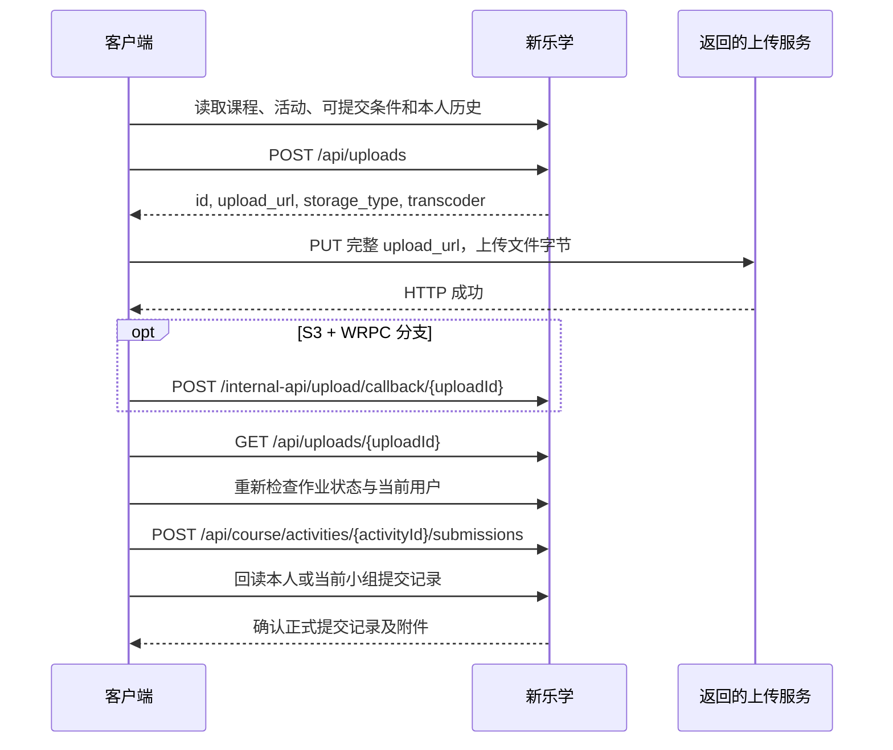

# 新乐学

基础地址：`https://zy-eclass.bit.edu.cn`。本页描述底层 HTTP 与 JSON；见 [清单](../catalog/endpoints.json) 的 `lms.*` 和 [OpenAPI](../openapi/lms.json)。它与延河课堂 `courseapi` 不是同一套认证和资源编号。

## 会话、课程与当前学生

使用本人正常登录产生的会话。参考客户端请求携带 Cookie，JSON 写入时如果存在 `XSRF-TOKEN`，URL 解码后放入 `X-XSRF-TOKEN`。没有观察到该 Cookie 时不凭空生成一个。登录 HTML、重定向或错误页不能当成功 JSON。

`GET /api/my-courses` 消费 `courses[]` 或 `data.courses[]`，课程字段包括 `id/name/course_code/academic_year/semester/department`。

`academic_year` 和 `semester` 可能为对象：学年优先读取 `name/start_year/end_year`，学期优先读取 `name/semester_index`。不得直接转字符串，否则会显示 `[object Object]`。无法识别的学期保留课程但不生成筛选选项，时间筛选统一使用已解析学期。

`GET /course/{courseId}/content` 返回 HTML，参考客户端从 `id="userId"` 的元素读取 `data-id`。本人提交记录的 student ID 来源于该会话，不接收调用者任意指定的学生编号。

## 课程活动、资料与作业

`GET /api/course/{courseId}/courseware-activities` 可能返回直接数组，也可能包装在 `learning_activities/courseware_activities/activities`。消费 `id/type/title/published`，并检查显式隐藏、不可用、已删除等字段。需要验证活动实际属于目标课程。

`GET /api/activities/{activityId}/resources` 返回 `uploads[]`，关注 `id/reference_id/name/size/type/allow_download/deleted`。这与 `GET /api/activities/{activityId}` 返回的作业说明附件不同；后者还返回题目正文、作业类型、提交时间和次数等。

作业列表使用 `/api/courses/{courseId}/homework-activities?page=…`，注意这里是复数 **courses**。提交状态汇总使用 `/api/course/{courseId}/homework/submission-status`，这里却是单数 **course**。状态汇总失败时保留“未知”，不要把“未读到状态”渲染成“未提交”。

典型作业字段：

| 字段 | 消费方式 |
| --- | --- |
| `course_id/type/published` | 课程归属、活动类型和发布状态 |
| `data.description` | 富文本题目，呈现前清理不可信 HTML |
| `data.homework_type` | 参考实现仅直接提交 `file_upload` |
| `data.mode` | 参考实现直接提交普通 `normal` 模式 |
| `is_in_progress/is_closed` | 当前是否在提交时间内 |
| `non_submit_times/submit_times/user_submit_count` | 是否不限次数、次数上限和已提交次数 |
| `submit_by_group/group_set_id` | 小组模式与小组集合 |
| `uploads` | 题目附件，不是学生本次选择的文件 |

上述提交范围是参考客户端当前支持范围，不是平台所有作业类型的完整枚举。

## 本人及小组提交记录

- 个人：`GET /api/activities/{activityId}/students/{userId}/submission_list`。
- 当前小组：先 `GET /api/group-sets/{groupSetId}/group` 取得 `group.id`，再 `GET /api/activities/{activityId}/groups/{groupId}/submission_list`。

消费 `list[].id/comment/created_at/is_draft/is_redo/uploads`。没有小组、记录读取失败和空记录分别处理。已经上传一个文件不会自动生成作业提交记录，草稿也不等于正式提交。

## 附件下载

| 情形 | 请求 |
| --- | --- |
| 有有效 `reference_id` | `GET /api/uploads/reference/{referenceId}/blob` |
| 没有引用号但有文件 ID，例如个人提交附件 | `GET /api/uploads/{uploadId}/blob` |
| 已开放下载的文件夹 | `GET /zip/uploads?timezone=-480&upload_ids={folderId}` |

依据平台返回的 `allow_download` 判断开放状态。文件响应可能通过重定向交给媒体服务；浏览器下载能够处理的链接不一定允许普通网页 fetch 跨域读取。资料中看到附件名称，不代表此会话拥有任意文件 ID 的下载权限。

## 完整上传和提交流程



### 1. 创建文件记录

参考客户端发送的 JSON 形状如下，名称和大小为合成值：

```json
{
  "name": "example.bin",
  "size": 3,
  "parent_type": null,
  "parent_id": 0,
  "is_scorm": false,
  "is_wmpkg": false,
  "source": "",
  "is_marked_attachment": false,
  "embed_material_type": ""
}
```

发送到 `POST /api/uploads`，已观察到 HTTP `201`。读取 `id/upload_url/storage_type/transcoder`。这一步只创建平台文件记录，尚未发送文件字节，不能报告“附件已提交”。

### 2. 上传字节

使用返回的完整 `upload_url`，保留 host、path 和 query：

| 分支 | 已有参考行为 | 验证范围 |
| --- | --- | --- |
| `MEDIA`，观测 host 为 `zy-media.bit.edu.cn` | `PUT /upload/file/{uploadId}`，`multipart/form-data`，表单项名 `file` | 已有经用户授权的真实普通附件上传及后续提交记录 |
| 新乐学同源 LOCAL 地址 | PUT 到原始地址，FormData 的 `file` 项 | 合成接口验证 |
| `storage_type=S3` 且 `transcoder=WRPC`，受支持的同源地址 | PUT 原始 Blob，`application/octet-stream`；再发上传回调 | 依据客户端源码，未做真实分支验收 |
| QINIU 或未支持的上传目的地 | 参考插件交回原站处理 | 本文不提供完整协议 |

MEDIA 分支的参考实现使用 `credentials=omit`，不转发新乐学 Cookie 或 CSRF 头。浏览器生成 multipart boundary，不手写缺少 boundary 的 Content-Type。不能截取媒体 URL 的 pathname 后拼回新乐学域，否则上传会发往错误服务器。

S3/WRPC 回调为 `POST /internal-api/upload/callback/{uploadId}`，参考请求体是 `{ "file_key": <数值 uploadId> }`。MEDIA 分支不发送这个回调。

### 3. 校验文件状态

`GET /api/uploads/{uploadId}` 检查同一个文件 ID、未删除状态及 `status`。参考实现接受 `ready/processing`；完整平台状态枚举未确认。不要只凭创建上传时已有的 `status=ready` 推断字节传输已经完成。

### 4. 正式提交作业

在用户明确执行提交后，重新读取作业、当前会话学生及文件归属。参考客户端发送：

```json
{
  "comment": "<p>示例说明</p>",
  "uploads": [60001],
  "slides": [],
  "is_draft": false,
  "mode": "normal",
  "other_resources": [],
  "uploads_in_rich_text": []
}
```

路径为 `POST /api/course/activities/{activityId}/submissions`，不是 `/api/activities/…/submissions`。`uploads` 是本次文件 ID 数组，不是题目附件引用编号。已观察到成功返回 HTTP `201`；参考客户端还兼容回执字段 `submission.id/submission_id/id` 以及无正文的 `204`，后者属于兼容行为，未在本次真实提交中逐一观察。

`comment` 为 HTML。普通文字应转义后构造 HTML，不能把不可信网页 HTML 原样透传。

### 5. 回读确认和异常

有回执编号时在本人历史中找到相同的非草稿记录。没有回执或响应中断时，比较提交前后的记录，核对新的正式记录、上传文件 ID 集合和说明；只有一个明确匹配项时才确认成功。结果含糊时继续核对，不自动重发 POST。

参考插件的 `requestId` 是本地会话内去重标识，没有放进上述平台 JSON，也不是平台承诺的服务端幂等键。参考插件的每个附件 32 MB、最多 30 个文件及纯文本说明上限，也是客户端限制，不能据此声明平台的文件上限。

直接提交补交、重做、编辑服务器草稿、特殊作业和全部存储后端还未完成适配。这里列出相关字段和只读记录，不把未完成的流程包装成通用提交 SDK。
